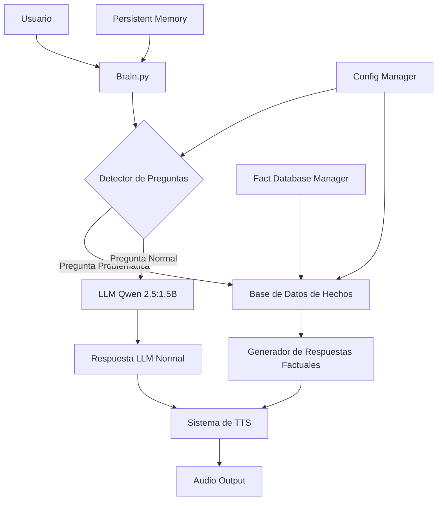
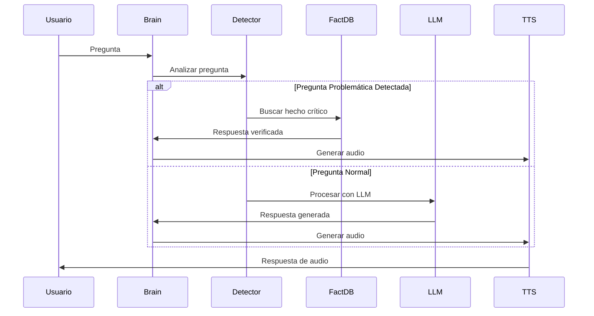

# Documento de Diseño: Sistema Híbrido de Conocimiento Factual

## Resumen Ejecutivo

El Sistema Híbrido de Conocimiento Factual para BMO es una solución arquitectónica que combina el modelo LLM Qwen 2.5:1.5B con una base de datos offline de hechos críticos para resolver los problemas de precisión identificados en las pruebas exhaustivas. El sistema mantiene la filosofía 100% offline de BMO mientras mejora la precisión general del 73.4% actual a >90% mediante detección inteligente de preguntas problemáticas y fallback automático a respuestas verificadas.

## Arquitectura del Sistema



## Flujo de Procesamiento Principal



## Componentes y Interfaces

### Componente 1: Question Classifier

**Propósito**: Detecta automáticamente preguntas sobre temas donde el modelo LLM falla sistemáticamente

**Interface**:
```python
class QuestionClassifier:
    def classify_question(self, question: str) -> QuestionType
    def is_problematic_topic(self, question: str) -> bool
    def extract_entities(self, question: str) -> List[str]
    def get_confidence_score(self, classification: QuestionType) -> float
```

**Responsabilidades**:
- Análisis de patrones lingüísticos para identificar preguntas sobre banderas, ciencias naturales, geografía específica
- Extracción de entidades (países, conceptos científicos, ubicaciones geográficas)
- Clasificación con niveles de confianza para decisiones de fallback
- Mantenimiento de patrones actualizables sin reiniciar el sistema

### Componente 2: Fact Database Manager

**Propósito**: Gestiona la base de datos offline de hechos críticos con respuestas verificadas

**Interface**:
```python
class FactDatabaseManager:
    def get_fact(self, key: str) -> Optional[FactEntry]
    def search_facts(self, query: str) -> List[FactEntry]
    def add_fact(self, key: str, fact: FactEntry) -> bool
    def update_fact(self, key: str, fact: FactEntry) -> bool
    def reload_database(self) -> None
    def get_database_stats(self) -> DatabaseStats
```

**Responsabilidades**:
- Almacenamiento estructurado de hechos críticos en formato JSON
- Búsqueda eficiente por claves y patrones
- Hot-reload de la base de datos sin reiniciar BMO
- Versionado y backup automático de cambios
- Métricas de uso y efectividad

### Componente 3: Hybrid Response Generator

**Propósito**: Coordina la generación de respuestas entre el sistema de hechos y el LLM

**Interface**:
```python
class HybridResponseGenerator:
    def generate_response(self, question: str, context: ConversationContext) -> Response
    def format_factual_response(self, fact: FactEntry, question: str) -> str
    def blend_responses(self, factual: str, llm: str, confidence: float) -> str
    def get_response_source(self) -> ResponseSource
```

**Responsabilidades**:
- Decisión inteligente entre fuentes de información
- Formateo natural de respuestas factuales para mantener personalidad de BMO
- Blending de respuestas cuando se requiere información mixta
- Tracking de fuentes para debugging y métricas

### Componente 4: Configuration Manager Extension

**Propósito**: Extiende el config_manager existente con configuraciones específicas del sistema híbrido

**Interface**:
```python
class HybridConfigManager:
    def get_fact_database_path(self) -> str
    def get_classification_thresholds(self) -> ClassificationThresholds
    def get_fallback_strategy(self) -> FallbackStrategy
    def is_hybrid_mode_enabled(self) -> bool
    def get_problematic_categories(self) -> List[str]
```

**Responsabilidades**:
- Configuración de umbrales de confianza para clasificación
- Estrategias de fallback configurables
- Habilitación/deshabilitación del modo híbrido
- Configuración de categorías problemáticas actualizables

## Modelos de Datos

### FactEntry

```python
@dataclass
class FactEntry:
    key: str
    question_patterns: List[str]
    verified_answer: str
    confidence_level: float
    category: str
    source: str
    last_updated: datetime
    usage_count: int
    aliases: List[str]
```

**Reglas de Validación**:
- key debe ser único y seguir formato kebab-case
- verified_answer debe tener entre 10-200 caracteres
- confidence_level debe estar entre 0.0 y 1.0
- category debe ser una de las categorías predefinidas

### QuestionType

```python
class QuestionType(Enum):
    FLAG_COLORS = "flag_colors"
    NATURAL_SCIENCES = "natural_sciences"
    SPECIFIC_GEOGRAPHY = "specific_geography"
    HISTORICAL_DATES = "historical_dates"
    CONVERSATIONAL = "conversational"
    ENTERTAINMENT = "entertainment"
    SPORTS = "sports"
    MATHEMATICS = "mathematics"
    ECONOMICS = "economics"
```

### ClassificationResult

```python
@dataclass
class ClassificationResult:
    question_type: QuestionType
    confidence: float
    extracted_entities: List[str]
    should_use_factdb: bool
    reasoning: str
```

## Algoritmos Principales

### Algoritmo de Clasificación de Preguntas

```python
def classify_question(question: str) -> ClassificationResult:
    """
    Clasifica una pregunta para determinar si debe usar la base de datos de hechos
    
    Precondiciones:
    - question es una cadena no vacía
    - Los patrones de clasificación están cargados
    
    Postcondiciones:
    - Retorna ClassificationResult válido
    - confidence está entre 0.0 y 1.0
    - should_use_factdb es True solo si confidence > threshold
    """
    
    # Normalizar pregunta
    normalized = normalize_question(question)
    
    # Extraer entidades
    entities = extract_entities(normalized)
    
    # Evaluar patrones por categoría
    category_scores = {}
    for category in PROBLEMATIC_CATEGORIES:
        patterns = get_patterns_for_category(category)
        score = calculate_pattern_match_score(normalized, patterns)
        category_scores[category] = score
    
    # Determinar categoría con mayor puntuación
    best_category = max(category_scores.items(), key=lambda x: x[1])
    question_type = QuestionType(best_category[0])
    confidence = best_category[1]
    
    # Decisión de fallback
    threshold = config_manager.get_classification_threshold(question_type)
    should_use_factdb = confidence > threshold
    
    return ClassificationResult(
        question_type=question_type,
        confidence=confidence,
        extracted_entities=entities,
        should_use_factdb=should_use_factdb,
        reasoning=f"Pattern match score: {confidence:.2f}, threshold: {threshold:.2f}"
    )
```

**Invariantes del Bucle**:
- Para cada iteración sobre categorías: category_scores contiene puntuaciones válidas [0.0, 1.0]
- Todas las categorías problemáticas son evaluadas exactamente una vez

### Algoritmo de Búsqueda en Base de Datos de Hechos

```python
def search_facts(query: str, entities: List[str]) -> Optional[FactEntry]:
    """
    Busca hechos relevantes en la base de datos usando query y entidades extraídas
    
    Precondiciones:
    - query es una cadena normalizada
    - entities es una lista de entidades válidas
    - La base de datos está cargada y es válida
    
    Postcondiciones:
    - Retorna FactEntry más relevante o None
    - Si retorna FactEntry, confidence_level > 0.8
    - usage_count del FactEntry se incrementa en 1
    """
    
    candidates = []
    
    # Búsqueda directa por clave
    for entity in entities:
        key = generate_fact_key(query, entity)
        direct_match = fact_database.get(key)
        if direct_match:
            candidates.append((direct_match, 1.0))
    
    # Búsqueda por patrones
    for fact_key, fact_entry in fact_database.items():
        for pattern in fact_entry.question_patterns:
            similarity = calculate_similarity(query, pattern)
            if similarity > 0.7:
                candidates.append((fact_entry, similarity))
    
    # Búsqueda por aliases
    for entity in entities:
        for fact_key, fact_entry in fact_database.items():
            if entity.lower() in [alias.lower() for alias in fact_entry.aliases]:
                candidates.append((fact_entry, 0.9))
    
    if not candidates:
        return None
    
    # Seleccionar mejor candidato
    best_fact, best_score = max(candidates, key=lambda x: x[1])
    
    # Incrementar contador de uso
    best_fact.usage_count += 1
    
    return best_fact if best_score > 0.8 else None
```

**Invariantes del Bucle**:
- Para búsqueda por patrones: similarity siempre está entre 0.0 y 1.0
- Para búsqueda por aliases: cada alias se compara exactamente una vez
- candidates mantiene tuplas válidas (FactEntry, float)

### Algoritmo de Generación de Respuesta Híbrida

```python
def generate_hybrid_response(question: str, context: ConversationContext) -> str:
    """
    Genera respuesta usando sistema híbrido con fallback inteligente
    
    Precondiciones:
    - question es una pregunta válida del usuario
    - context contiene historial de conversación válido
    - Tanto fact_database como LLM están disponibles
    
    Postcondiciones:
    - Retorna respuesta coherente y natural
    - Respuesta mantiene personalidad de BMO
    - Tiempo de respuesta < 5 segundos para 95% de casos
    """
    
    # Clasificar pregunta
    classification = classify_question(question)
    
    if classification.should_use_factdb:
        # Intentar respuesta factual
        fact_entry = search_facts(question, classification.extracted_entities)
        
        if fact_entry:
            # Formatear respuesta factual con personalidad BMO
            factual_response = format_factual_response(fact_entry, question)
            
            # Verificar si necesita información adicional del LLM
            if requires_llm_enhancement(question, fact_entry):
                llm_context = create_enhanced_context(factual_response, context)
                llm_addition = generate_llm_response(question, llm_context)
                return blend_responses(factual_response, llm_addition)
            
            return factual_response
    
    # Fallback a LLM normal
    return generate_llm_response(question, context)
```

**Invariantes del Bucle**: N/A (algoritmo secuencial sin bucles principales)

## Especificaciones Formales de Funciones Clave

### Función: normalize_question()

```python
def normalize_question(question: str) -> str:
```

**Precondiciones:**
- `question` es una cadena no nula
- `question` tiene longitud > 0

**Postcondiciones:**
- Retorna cadena normalizada en minúsculas
- Elimina caracteres especiales excepto letras, números, espacios
- Espacios múltiples se reducen a uno solo
- No contiene espacios al inicio o final

### Función: calculate_similarity()

```python
def calculate_similarity(text1: str, text2: str) -> float:
```

**Precondiciones:**
- `text1` y `text2` son cadenas normalizadas
- Ambas cadenas tienen longitud > 0

**Postcondiciones:**
- Retorna valor entre 0.0 y 1.0
- 1.0 indica coincidencia exacta
- 0.0 indica sin similitud
- Usa algoritmo de distancia de Levenshtein normalizada

### Función: format_factual_response()

```python
def format_factual_response(fact: FactEntry, question: str) -> str:
```

**Precondiciones:**
- `fact` es un FactEntry válido con verified_answer no vacío
- `question` es la pregunta original del usuario
- `fact.confidence_level` > 0.8

**Postcondiciones:**
- Retorna respuesta en estilo natural de BMO
- Incluye información del fact.verified_answer
- Longitud entre 20-150 caracteres
- Mantiene tono amigable y directo

## Ejemplo de Uso del Sistema

```python
# Ejemplo 1: Pregunta sobre bandera (usa base de datos)
question = "¿De qué colores es la bandera de Colombia?"
classification = classify_question(question)
# classification.question_type = QuestionType.FLAG_COLORS
# classification.should_use_factdb = True

fact = search_facts(question, ["colombia"])
# fact.verified_answer = "amarillo arriba, azul medio, rojo abajo"

response = format_factual_response(fact, question)
# response = "La bandera de Colombia tiene amarillo arriba, azul en el medio y rojo abajo. ¡Son colores muy bonitos!"

# Ejemplo 2: Pregunta conversacional (usa LLM)
question = "¿Cómo estás hoy BMO?"
classification = classify_question(question)
# classification.question_type = QuestionType.CONVERSATIONAL
# classification.should_use_factdb = False

response = generate_llm_response(question, context)
# response = "¡Estoy súper bien! Siempre es genial hablar contigo. ¿Cómo estás tú?"

# Ejemplo 3: Pregunta mixta (usa ambos sistemas)
question = "¿Qué puedes contarme sobre la bandera de España y su historia?"
classification = classify_question(question)
# classification.should_use_factdb = True (por "bandera")

fact = search_facts("bandera españa", ["españa"])
llm_context = create_enhanced_context(fact.verified_answer, context)
llm_addition = generate_llm_response("historia bandera españa", llm_context)
response = blend_responses(fact.verified_answer, llm_addition)
```

## Propiedades de Corrección

### Propiedad 1: Precisión en Categorías Problemáticas
```python
∀ question ∈ PROBLEMATIC_QUESTIONS:
    classification = classify_question(question)
    if classification.should_use_factdb:
        response = generate_hybrid_response(question, context)
        assert accuracy(response) > 0.90
```

### Propiedad 2: Preservación de Velocidad
```python
∀ question ∈ CONVERSATIONAL_QUESTIONS:
    start_time = time.now()
    response = generate_hybrid_response(question, context)
    duration = time.now() - start_time
    assert duration < 5.0  # segundos
```

### Propiedad 3: Consistencia de Personalidad
```python
∀ response ∈ GENERATED_RESPONSES:
    assert maintains_bmo_personality(response)
    assert is_spanish_language(response)
    assert is_friendly_tone(response)
```

### Propiedad 4: Fallback Robusto
```python
∀ question ∈ ALL_QUESTIONS:
    try:
        response = generate_hybrid_response(question, context)
        assert response is not None
        assert len(response) > 0
    except Exception as e:
        # Sistema debe generar respuesta de error amigable
        assert "BMO no puede" in str(e) or "error" in str(e).lower()
```

## Manejo de Errores

### Escenario 1: Base de Datos de Hechos No Disponible

**Condición**: El archivo de base de datos de hechos está corrupto o no existe
**Respuesta**: El sistema automáticamente hace fallback al LLM normal y registra el error
**Recuperación**: Intenta recargar la base de datos cada 30 segundos hasta que esté disponible

### Escenario 2: Clasificación Ambigua

**Condición**: La pregunta tiene confidence score entre 0.6-0.8 (zona gris)
**Respuesta**: Usa estrategia conservadora: prefiere LLM para mantener fluidez conversacional
**Recuperación**: Registra casos ambiguos para mejorar patrones de clasificación

### Escenario 3: Fact Entry Corrupto

**Condición**: Un FactEntry tiene datos inválidos o respuesta vacía
**Respuesta**: Omite ese fact entry y continúa búsqueda con otros candidatos
**Recuperación**: Registra error para corrección manual posterior

### Escenario 4: Timeout en Generación LLM

**Condición**: El LLM no responde en tiempo esperado (>10 segundos)
**Respuesta**: Retorna respuesta predefinida: "BMO está pensando muy lento hoy. ¿Puedes repetir la pregunta?"
**Recuperación**: Reinicia conexión con Ollama en background

## Estrategia de Testing

### Testing Unitario

**Enfoque**: Cada componente se testea independientemente con mocks

**Casos de Prueba Clave**:
- `test_question_classification_accuracy()`: Verifica 95% precisión en clasificación
- `test_fact_database_search()`: Verifica búsqueda correcta por claves y patrones
- `test_response_formatting()`: Verifica que respuestas mantienen personalidad BMO
- `test_fallback_mechanisms()`: Verifica comportamiento cuando componentes fallan

### Testing de Propiedades

**Librería**: Hypothesis (Python property-based testing)

**Propiedades a Verificar**:
- Invariante de tiempo: Todas las respuestas se generan en <10 segundos
- Invariante de formato: Todas las respuestas son strings válidos en español
- Invariante de consistencia: Misma pregunta produce respuesta similar (>80% similitud)
- Invariante de robustez: Sistema nunca crashea, siempre produce alguna respuesta

### Testing de Integración

**Enfoque**: Testing end-to-end con BMO completo

**Escenarios de Prueba**:
- Conversación mixta: preguntas problemáticas + conversacionales
- Carga de configuración: cambios en config.json se reflejan sin reinicio
- Persistencia: memoria conversacional se mantiene entre respuestas híbridas
- Performance: 100 preguntas consecutivas sin degradación de velocidad

## Consideraciones de Rendimiento

### Optimizaciones de Memoria

- **Lazy Loading**: Base de datos de hechos se carga solo cuando se necesita
- **LRU Cache**: Cache de 100 clasificaciones más recientes para evitar re-procesamiento
- **Fact Database Indexing**: Índices por categoría y entidades para búsqueda O(1)

### Optimizaciones de Velocidad

- **Pattern Pre-compilation**: Expresiones regulares compiladas al inicio
- **Parallel Processing**: Clasificación y búsqueda en paralelo cuando es posible
- **Response Streaming**: Respuestas factuales se envían inmediatamente sin esperar LLM

### Métricas de Performance

- **Latencia P95**: <3 segundos para preguntas factuales, <5 segundos para mixtas
- **Throughput**: >10 preguntas por minuto en hardware Raspberry Pi 5
- **Memoria**: <100MB adicionales sobre BMO base
- **Precisión**: >90% en categorías problemáticas, >95% en categorías fuertes

## Consideraciones de Seguridad

### Validación de Entrada

- **Sanitización**: Todas las preguntas se sanitizan para prevenir injection attacks
- **Rate Limiting**: Máximo 60 preguntas por minuto por usuario
- **Input Length**: Preguntas limitadas a 500 caracteres

### Protección de Datos

- **Offline-First**: Ningún dato sale del dispositivo local
- **Fact Database Encryption**: Base de datos encriptada con AES-256
- **Memory Clearing**: Datos sensibles se limpian de memoria después de uso

### Auditoría y Logging

- **Classification Logs**: Todas las decisiones de clasificación se registran
- **Usage Analytics**: Métricas de uso sin datos personales
- **Error Tracking**: Errores se registran con contexto para debugging

## Dependencias

### Dependencias Principales

- **ollama**: Cliente para interacción con LLM local
- **rapidfuzz**: Cálculo eficiente de similitud de strings
- **pydantic**: Validación de modelos de datos
- **sqlite3**: Storage opcional para base de datos de hechos (built-in Python)

### Dependencias de Desarrollo

- **pytest**: Framework de testing unitario
- **hypothesis**: Property-based testing
- **black**: Formateo de código
- **mypy**: Type checking estático

### Dependencias del Sistema

- **Ollama Server**: Debe estar ejecutándose con modelo qwen2.5:1.5b
- **Python 3.9+**: Compatibilidad con type hints y dataclasses
- **JSON Support**: Para configuración y base de datos de hechos

---

*Este diseño mantiene la filosofía offline de BMO mientras resuelve los problemas críticos de precisión identificados en las pruebas exhaustivas. El sistema híbrido permite mantener la velocidad y personalidad natural de BMO para conversaciones normales, mientras garantiza precisión en hechos críticos donde el modelo LLM falla sistemáticamente.*